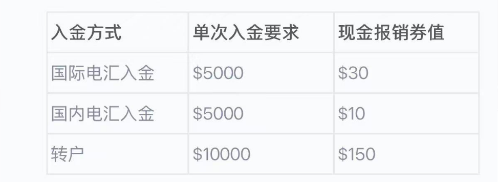

# 必贝（BBEA）入金流程

## 方案一 港卡-必贝（BBEA）
港卡通过电汇的方式直接电汇美元入金必贝，是一个比较简单直接且稳定的方案，比较适合大额。
 

主流港卡电汇入金指南：

- [众安银行](https://www.bbae.com/zh-cn/%E5%8D%9A%E5%AE%A2/%E4%BC%97%E5%AE%89%E9%93%B6%E8%A1%8C%E7%94%B5%E6%B1%87%E5%85%A5%E9%87%91%E6%8C%87%E5%8D%97/)
- [汇丰银行](https://www.bbae.com/zh-cn/%E5%8D%9A%E5%AE%A2/%E6%B1%87%E4%B8%B0%E9%93%B6%E8%A1%8C%E7%94%B5%E6%B1%87%E5%85%A5%E9%87%91%E6%8C%87%E5%8D%97/)
- [中银香港](https://www.bbae.com/zh-cn/%E5%8D%9A%E5%AE%A2/%E4%B8%AD%E9%93%B6%E9%A6%99%E6%B8%AF%E7%94%B5%E6%B1%87%E5%85%A5%E9%87%91%E6%8C%87%E5%8D%97/)
- [渣打香港](https://www.bbae.com/zh-cn/%E5%8D%9A%E5%AE%A2/%E6%B8%A3%E6%89%93%E9%93%B6%E8%A1%8C%EF%BC%88%E9%A6%99%E6%B8%AF%EF%BC%89%E7%94%B5%E6%B1%87%E5%85%A5%E9%87%91%E6%8C%87%E5%8D%97/)
- [恒生银行](https://www.bbae.com/zh-cn/%E5%8D%9A%E5%AE%A2/%E6%81%92%E7%94%9F%E9%93%B6%E8%A1%8C%E7%94%B5%E6%B1%87%E5%85%A5%E9%87%91%E6%8C%87%E5%8D%97/)
- [工银亚洲](https://www.bbae.com/zh-cn/%E5%8D%9A%E5%AE%A2/%e5%b7%a5%e9%93%b6%e4%ba%9a%e6%b4%b2%e7%94%b5%e6%b1%87%e5%85%a5%e9%87%91%e6%8c%87%e5%8d%97/)

**费用**：**20美金**左右。  
虽然多数汇出行比如汇丰、众安都不收取汇出费，必贝也不收取转入费，但是中间行还是收费。
不过必贝官方有一个入金补贴活动，满足对应金额可以报销，如果金额大别忘领：

**时间**：1~3天。  

**注意事项**：
1. 千万不要拿小额试，试一次就是一次固定的费用。
2. 港卡中优先用汇丰、渣打、众安去电汇：
   - 汇丰：120 港币
   - 渣打：50 港币
   - 众安：20 美金

## 方案二 wise-必贝（BBEA）
和嘉信、盈透、第一这些券商不同，必贝不支持和wise之间进行ACH绑定。所以，使用wise，我们只能通过wise电汇方式走。
- Wise电汇入金必贝流程：https://www.bbae.com/zh-cn/%E5%8D%9A%E5%AE%A2/wise/

**费用**：**1.13美金**，性价比相当高了，瞬间觉得ACH也没那么香了。  
**时间**：1~3天。 

**注意事项**：
1. wise不如传统银行稳定，大金额还是银行更适合（>5000美金）。
2. wise电汇不能把你的必贝id带过去，需要再给必贝发个邮件才行，这点不要忘记。

## 方案三 港卡-wise-华美-必贝（BBEA）
必贝不支持和wise进行ACH绑定，但是却能跟华美绑定。  
如果你同时持有wise和华美，也可以先将港卡中的美金通过chats方式转入wise，再由wise转到华美（wise和华美之间可以绑定，出入免费），由华美ACH方式入金必贝。

**费用**：全程只有**1.27美元**的费用（港卡转美金到wise港币账户这个环节）
**时间**：2~5天。

## 方案四 美国券商（嘉信/盈透/第一）-必贝（BBEA）
美国券商之间是可以通过**ACATS**进行转仓的。  
以嘉信为例，选择部分转出是不收费的，如果全部转出，则收费。举个例子，你的账户有100股QQQ，200现金，如果只转QQQ，是不收费的，但是全部转走就收费50美金了。

**转仓教程**：[如何将证券从其他券商转至 BBAE？](https://www.bbae.com/zh-cn/%E5%B8%AE%E5%8A%A9/%e8%bd%ac%e6%88%b7%e7%9b%b8%e5%85%b3/#3927-%e5%a6%82%e4%bd%95%e5%b0%86%e8%af%81%e5%88%b8%e4%bb%8e%e5%85%b6%e4%bb%96%e5%88%b8%e5%95%86%e8%bd%ac%e8%87%b3bbae%ef%bc%9f)

**费用**：0

**时间**：3~7天。

---

## 总结
方案一银行对银行，没有中间节点，稳定可追溯，适合大金额入金的朋友，缺点是单次手续费略高。  

方案二损耗最低，适合小额多次入金，缺点是不如银行这么稳定。  

方案三适合已经有美卡的朋友，对各个工具流程比较熟悉，愿意折腾，全程可以做到0损，但是入金周期会比较久。 

方案四适合已经有美国券商的朋友，0损耗。

