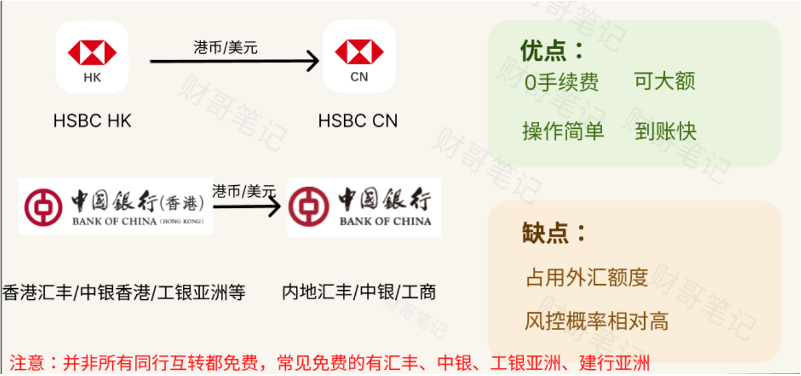
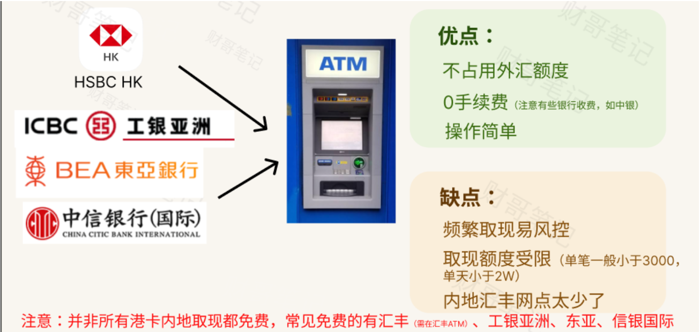
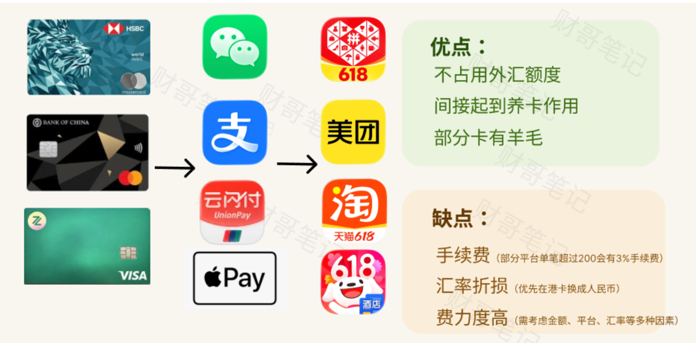
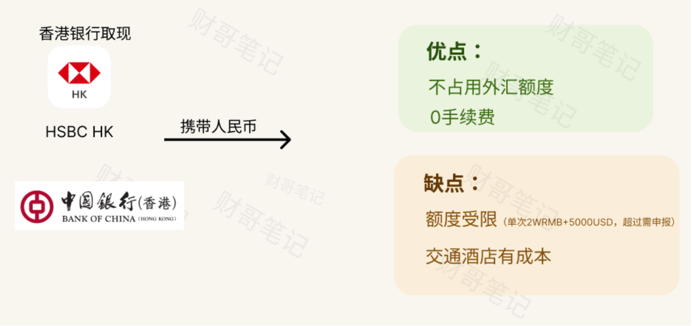

资金从香港到内地，5种低成本方案：
> 💡 **快速通道**：[查看美股教程主干道](../README.md)
## 方案一：同行互转

香港银行直接转内地，在内地结汇，是资金回国的一个标准方案，**适合大额**。

而相同银行又有手续费的优势，推荐能同行则同行。

很多朋友国内没有汇丰，可以考虑在香港先把钱转到中银，再用中银通道回国。

## 方案二：港卡在国内ATM取现

适合临时取现国内周转，**小额应急**。

**注意：并非所有的银行取现都是免费，中银在内地取现会收50人民币手续费。**

而且最好在香港的时候就换成人民币，国内ATM直接按取港卡人民币余额。香港有些券商和一些数字银行汇率还可以。

## 方案三：港卡绑国内平台消费

适合**小额高频消费**，个人最喜欢的一种方案。

和方案二一样，优先在香港换成人民币，国内消费直接扣人民币。

日常刷的时候要注意超额手续费问题，**3%的手续费还是很贵的**。

而且这种方案还间接保持了港卡的活跃性，不至于因卡长期未使用被冻结，也算一举两得。很多朋友汇丰被冻卡，一个很重要的因素就是长期不活跃，突然之间有钱进来。

此外，有条件的还可以上车汇丰pulse，有**4.4%消费返现**，很不错一张卡。

## 方案四：香港取现后带回来

适合旅游去香港顺便操作，直接取人民币背回来，注意不要背太多。

## 方案五：港卡 → 第三方汇款平台 → 内地

有些朋友可能没有中银、建亚、工亚这些港卡，而汇丰、恒生、众安、渣打等港卡直接汇往内地，往往要收手续费，而且普遍不低（100 港币+）。

以汇出 10000 港币为例：

| 汇款渠道 | 到账（人民币） | 推荐程度 | 备注 |
| --- | --- | --- | --- |
| 中银香港 → 中银内地 | 8483 | 最优 | 占用每年 5 万美元额度 |
| 熊猫速汇 → 内地 | 8473 | 次优 | 每年限额 12 万港币，不占用 5 万美元额度 |
| Wise → 内地 | 8443 | 尚可 | 不占用 5 万美元额度 |
| 汇丰、恒生、众安、渣打 → 内地 | — | 不推荐 | 手续费 + 汇率折损，到账低于前三种方式 |

中银、建亚、工亚这些中资银行，在我看来最突出的优点就是：资金从香港回内地免费。

如果在香港没办或者办理失败，可以借用熊猫速汇或 Wise 这些平台小额汇款，损耗远低于港卡直接汇到国内结汇。

**熊猫速汇注册**：[通过财哥邀请链接注册](https://p.pandaremit.com/h5ditui/launchIndex?invtCode=77898420&area=HKG&type=ditui)

